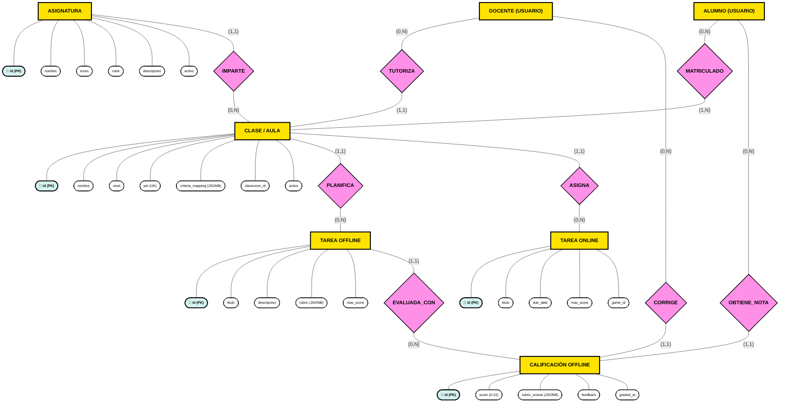
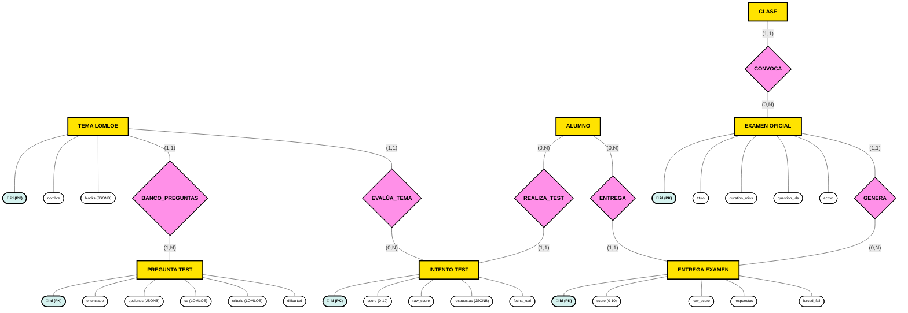
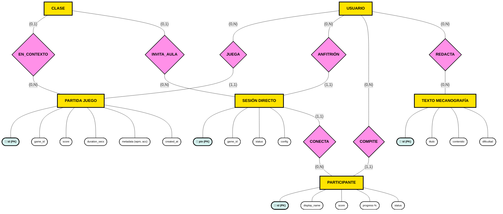

# 📐 Diagrama Entidad-Relación Conceptual (Notación de Chen): StackClass

Este documento contiene el **Modelo Conceptual Entidad-Relación (Peter Chen)** de la base de datos de **StackClass** en Supabase PostgreSQL.

### 🏷️ Simbología Utilizada (Modelo Chen)
* 🟨 **Rectángulos / Cuadrados:** Entidades (`[ENTIDAD]`).
* 🔷 **Rombos:** Relaciones (`{RELACIÓN}`).
* ⚪ **Elipses / Óvalos:** Atributos (`([atributo])`), destacando en azul las **Claves Primarias (PK)** con `🔑`.
* 📏 **Líneas y Etiquetas:** Cardinalidades en formato `(mínimo, máximo)`: `(1,1)`, `(0,N)`, `(1,N)`, `(0,1)`.

---

## 🌟 1. Diagrama Chen Global del Sistema

```mermaid
flowchart TD
    %% Estilos Chen Neo-Brutalism
    classDef entity fill:#FFE300,stroke:#000000,stroke-width:3px,font-weight:800,color:#000000;
    classDef relation fill:#FF90E8,stroke:#000000,stroke-width:2px,font-weight:800,color:#000000;
    classDef attr fill:#FFFFFF,stroke:#000000,stroke-width:1.5px,color:#000000,font-size:11px;
    classDef pk fill:#D5F2EF,stroke:#000000,stroke-width:2.5px,font-weight:800,color:#000000,font-size:11px;

    %% ENTIDADES (RECTÁNGULOS)
    E_SUB["ASIGNATURA"]:::entity
    E_USER["USUARIO"]:::entity
    E_CLASS["CLASE / AULA"]:::entity
    E_TOPIC["TEMA LOMLOE"]:::entity
    E_QTEST["PREGUNTA TEST"]:::entity
    E_RTEST["INTENTO TEST"]:::entity
    E_OTASK["TAREA OFFLINE"]:::entity
    E_OGRADE["CALIFICACIÓN OFFLINE"]:::entity
    E_EXAM["EXAMEN OFICIAL"]:::entity
    E_REXM["ENTREGA EXAMEN"]:::entity
    E_GAME["PARTIDA JUEGO"]:::entity
    E_GUILD["GREMIO"]:::entity
    E_MEDAL["MEDALLA LOGRO"]:::entity
    E_LIVE["SESIÓN DIRECTO"]:::entity
    E_PART["PARTICIPANTE"]:::entity
    E_BOT["BOT ARENA"]:::entity

    %% ATRIBUTOS (ELIPSES)
    A_SUB_ID(["🔑 id (PK)"]):::pk
    A_SUB_NOM(["nombre"]):::attr
    E_SUB --- A_SUB_ID
    E_SUB --- A_SUB_NOM

    A_U_ID(["🔑 id (PK)"]):::pk
    A_U_EMAIL(["email (UK)"]):::attr
    A_U_NAME(["nombre"]):::attr
    A_U_ROL(["rol"]):::attr
    A_U_XP(["xp"]):::attr
    E_USER --- A_U_ID
    E_USER --- A_U_EMAIL
    E_USER --- A_U_NAME
    E_USER --- A_U_ROL
    E_USER --- A_U_XP

    A_C_ID(["🔑 id (PK)"]):::pk
    A_C_NAME(["nombre"]):::attr
    A_C_PIN(["pin (UK)"]):::attr
    A_C_MAP(["criteria_mapping"]):::attr
    E_CLASS --- A_C_ID
    E_CLASS --- A_C_NAME
    E_CLASS --- A_C_PIN
    E_CLASS --- A_C_MAP

    A_T_ID(["🔑 id (PK)"]):::pk
    A_T_NAME(["nombre"]):::attr
    E_TOPIC --- A_T_ID
    E_TOPIC --- A_T_NAME

    A_OT_ID(["🔑 id (PK)"]):::pk
    A_OT_TIT(["titulo"]):::attr
    A_OT_RUB(["rubric (JSONB)"]):::attr
    E_OTASK --- A_OT_ID
    E_OTASK --- A_OT_TIT
    E_OTASK --- A_OT_RUB

    A_OG_ID(["🔑 id (PK)"]):::pk
    A_OG_SCO(["score (0-10)"]):::attr
    A_OG_RSC(["rubric_scores"]):::attr
    A_OG_FBK(["feedback"]):::attr
    E_OGRADE --- A_OG_ID
    E_OGRADE --- A_OG_SCO
    E_OGRADE --- A_OG_RSC
    E_OGRADE --- A_OG_FBK

    A_EX_ID(["🔑 id (PK)"]):::pk
    A_EX_TIT(["titulo"]):::attr
    A_EX_DUR(["duracion_mins"]):::attr
    E_EXAM --- A_EX_ID
    E_EXAM --- A_EX_TIT
    E_EXAM --- A_EX_DUR

    A_G_ID(["🔑 id (PK)"]):::pk
    A_G_GID(["game_id"]):::attr
    A_G_SCO(["score"]):::attr
    E_GAME --- A_G_ID
    E_GAME --- A_G_GID
    E_GAME --- A_G_SCO

    %% RELACIONES (ROMBOS) Y CARDINALIDADES
    R_IMPARTE{"IMPARTE"}:::relation
    E_SUB ---|"(1,1)"| R_IMPARTE
    R_IMPARTE ---|"(0,N)"| E_CLASS

    R_TUTORA{"TUTORIZA"}:::relation
    E_USER ---|"(0,N)"| R_TUTORA
    R_TUTORA ---|"(1,1)"| E_CLASS

    R_MATRICULA{"MATRICULADO"}:::relation
    E_USER ---|"(0,N)"| R_MATRICULA
    R_MATRICULA ---|"(1,N)"| E_CLASS

    R_ORGANIZA{"ORGANIZA"}:::relation
    E_SUB ---|"(1,1)"| R_ORGANIZA
    R_ORGANIZA ---|"(1,N)"| E_TOPIC

    R_BANCO{"CONTIENE"}:::relation
    E_TOPIC ---|"(1,1)"| R_BANCO
    R_BANCO ---|"(1,N)"| E_QTEST

    R_EVAL_TEMA{"EVALÚA"}:::relation
    E_TOPIC ---|"(1,1)"| R_EVAL_TEMA
    R_EVAL_TEMA ---|"(0,N)"| E_RTEST

    R_HACE_TEST{"REALIZA"}:::relation
    E_USER ---|"(0,N)"| R_HACE_TEST
    R_HACE_TEST ---|"(1,1)"| E_RTEST

    R_ASIG_OFF{"PLANIFICA"}:::relation
    E_CLASS ---|"(1,1)"| R_ASIG_OFF
    R_ASIG_OFF ---|"(0,N)"| E_OTASK

    R_CALIF_OFF{"CALIFICA_CON"}:::relation
    E_OTASK ---|"(1,1)"| R_CALIF_OFF
    R_CALIF_OFF ---|"(0,N)"| E_OGRADE

    R_RECIBE_NOTA{"OBTIENE"}:::relation
    E_USER ---|"(0,N)"| R_RECIBE_NOTA
    R_RECIBE_NOTA ---|"(1,1)"| E_OGRADE

    R_CORRIGE{"EVALÚA"}:::relation
    E_USER ---|"(0,N)"| R_CORRIGE
    R_CORRIGE ---|"(1,1)"| E_OGRADE

    R_CONVOCA{"CONVOCA"}:::relation
    E_CLASS ---|"(1,1)"| R_CONVOCA
    R_CONVOCA ---|"(0,N)"| E_EXAM

    R_GENERA_ENT{"ENTREGA"}:::relation
    E_EXAM ---|"(1,1)"| R_GENERA_ENT
    R_GENERA_ENT ---|"(0,N)"| E_REXM

    R_ALUM_EXAM{"REALIZA"}:::relation
    E_USER ---|"(0,N)"| R_ALUM_EXAM
    R_ALUM_EXAM ---|"(1,1)"| E_REXM

    R_JUEGA{"JUEGA"}:::relation
    E_USER ---|"(0,N)"| R_JUEGA
    R_JUEGA ---|"(1,1)"| E_GAME

    R_GREMIO{"PERTENECE"}:::relation
    E_USER ---|"(0,1)"| R_GREMIO
    R_GREMIO ---|"(0,N)"| E_GUILD

    R_SUB_GUILD{"DEFINE"}:::relation
    E_SUB ---|"(1,1)"| R_SUB_GUILD
    R_SUB_GUILD ---|"(1,N)"| E_GUILD

    R_SUB_MEDAL{"OTORGA"}:::relation
    E_SUB ---|"(1,1)"| R_SUB_MEDAL
    R_SUB_MEDAL ---|"(1,N)"| E_MEDAL

    R_HOST{"CREA"}:::relation
    E_USER ---|"(0,N)"| R_HOST
    R_HOST ---|"(1,1)"| E_LIVE

    R_AGRUPA{"CONECTA"}:::relation
    E_LIVE ---|"(1,1)"| R_AGRUPA
    R_AGRUPA ---|"(0,N)"| E_PART

    R_COMPITE{"PARTICIPA"}:::relation
    E_USER ---|"(0,N)"| R_COMPITE
    R_COMPITE ---|"(1,1)"| E_PART

    R_PROG{"PROGRAMA"}:::relation
    E_USER ---|"(0,N)"| R_PROG
    R_PROG ---|"(1,1)"| E_BOT
```

---

## 🎓 2. Módulo Académico & Cuaderno Docente LOMLOE (Chen Detallado)

Muestra todas las entidades, relaciones y la totalidad de los atributos en elipses del subsistema de evaluación docente.

---

## 🏆 3. Módulo de Gamificación, Gremios y Ligas (Chen Detallado)

```mermaid
flowchart TD
    classDef entity fill:#FFE300,stroke:#000000,stroke-width:3px,font-weight:800,color:#000000;
    classDef relation fill:#FF90E8,stroke:#000000,stroke-width:2px,font-weight:800,color:#000000;
    classDef attr fill:#FFFFFF,stroke:#000000,stroke-width:1.5px,color:#000000,font-size:11px;
    classDef pk fill:#D5F2EF,stroke:#000000,stroke-width:2.5px,font-weight:800,color:#000000,font-size:11px;

    E_SUB["ASIGNATURA"]:::entity
    E_USER["USUARIO"]:::entity
    E_GUILD["GREMIO"]:::entity
    E_MEDAL["MEDALLA LOGRO"]:::entity
    E_LEAGUE["LIGA"]:::entity
    E_BOT["BOT ARENA"]:::entity

    %% Atributos USUARIO
    A_U1(["🔑 id (PK)"]):::pk
    A_U2(["email (UK)"]):::attr
    A_U3(["display_name"]):::attr
    A_U4(["display_name_anon"]):::attr
    A_U5(["xp"]):::attr
    A_U6(["logros (ARRAY)"]):::attr
    A_U7(["digital_wellbeing"]):::attr
    E_USER --- A_U1
    E_USER --- A_U2
    E_USER --- A_U3
    E_USER --- A_U4
    E_USER --- A_U5
    E_USER --- A_U6
    E_USER --- A_U7

    %% Atributos GREMIO
    A_G1(["🔑 id (PK)"]):::pk
    A_G2(["nombre"]):::attr
    A_G3(["icono"]):::attr
    A_G4(["color"]):::attr
    A_G5(["image_url"]):::attr
    A_G6(["lore"]):::attr
    E_GUILD --- A_G1
    E_GUILD --- A_G2
    E_GUILD --- A_G3
    E_GUILD --- A_G4
    E_GUILD --- A_G5
    E_GUILD --- A_G6

    %% Atributos MEDALLA
    A_M1(["🔑 id (PK)"]):::pk
    A_M2(["nombre"]):::attr
    A_M3(["descripcion"]):::attr
    A_M4(["xp_value"]):::attr
    A_M5(["icono"]):::attr
    E_MEDAL --- A_M1
    E_MEDAL --- A_M2
    E_MEDAL --- A_M3
    E_MEDAL --- A_M4
    E_MEDAL --- A_M5

    %% Atributos LIGA
    A_L1(["🔑 id (PK)"]):::pk
    A_L2(["nombre"]):::attr
    A_L3(["min_xp"]):::attr
    A_L4(["trofeo"]):::attr
    A_L5(["sort_order"]):::attr
    E_LEAGUE --- A_L1
    E_LEAGUE --- A_L2
    E_LEAGUE --- A_L3
    E_LEAGUE --- A_L4
    E_LEAGUE --- A_L5

    %% Atributos BOT
    A_B1(["🔑 id (PK)"]):::pk
    A_B2(["nombre"]):::attr
    A_B3(["codigo_js"]):::attr
    A_B4(["wins"]):::attr
    A_B5(["losses"]):::attr
    E_BOT --- A_B1
    E_BOT --- A_B2
    E_BOT --- A_B3
    E_BOT --- A_B4
    E_BOT --- A_B5

    %% Relaciones
    R_S_G{"CONTIENE"}:::relation
    E_SUB ---|"(1,1)"| R_S_G
    R_S_G ---|"(1,N)"| E_GUILD

    R_S_M{"OTORGA"}:::relation
    E_SUB ---|"(1,1)"| R_S_M
    R_S_M ---|"(1,N)"| E_MEDAL

    R_U_G{"AFILIADO_A"}:::relation
    E_USER ---|"(0,1)"| R_U_G
    R_U_G ---|"(0,N)"| E_GUILD

    R_U_M{"DESBLOQUEA"}:::relation
    E_USER ---|"(0,N)"| R_U_M
    R_U_M ---|"(0,N)"| E_MEDAL

    R_U_L{"CLASIFICA_EN"}:::relation
    E_USER ---|"(0,N)"| R_U_L
    R_U_L ---|"(1,1)"| E_LEAGUE

    R_U_B{"PROGRAMA"}:::relation
    E_USER ---|"(0,N)"| R_U_B
    R_U_B ---|"(1,1)"| E_BOT
```

---

## 📝 4. Módulo de Evaluación, Tests y Exámenes (Chen Detallado)

---

## 🎮 5. Módulo de Minijuegos & Telemetría en Vivo (Chen Detallado)

---

## 🌐 Visor Web Interactivo

Para interactuar con el diagrama completo, hacer zoom, arrastrar con el ratón o conmutar entre la notación **Chen** y la notación **Relacional SQL**, abre:

👉 **[database_er.html](file:///media/disco/dades/src/stackclass/database_er.html)**
